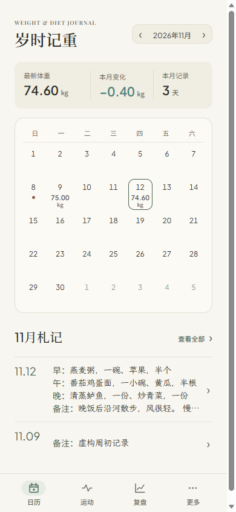
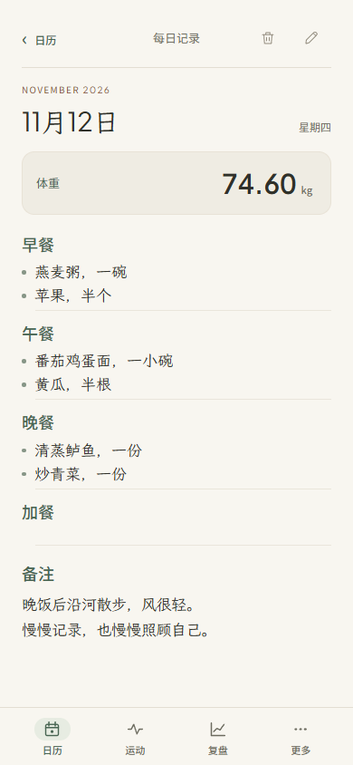
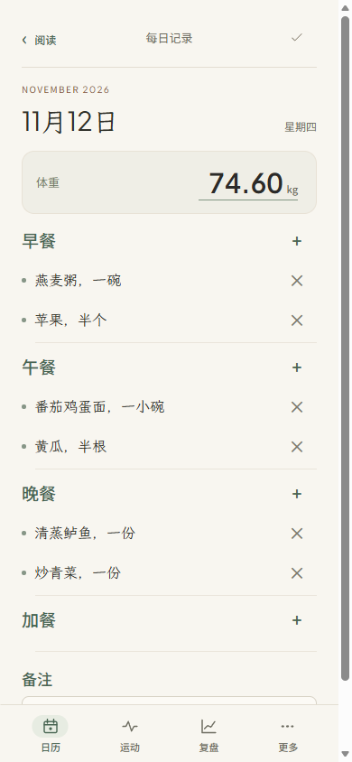
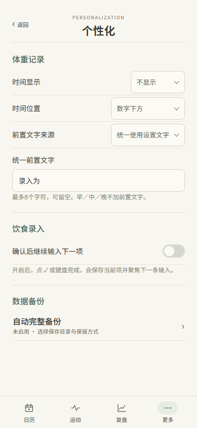

# 岁时记重

一款免费的 Android 体重、饮食、运动与日记记录 App。用温暖的纸张界面，留下每天的生活记录。

本仓库用于发布安装包、使用说明与问题反馈；应用开发源码暂不公开。

## 下载

在本仓库右侧 **Releases** 中选择 **v1.0.2**，下载 `Suishijizhong-1.0.2.apk`。请下载正式附件；GitHub 自动生成的 Source code 压缩包不是 Android 安装包。

- Android 5.0 及以上；建议使用较新版本 Android 与系统 WebView。最低版本要求不代表全部旧设备都经过测试。
- 包名：`com.suishijizhong.diary`。
- 免费使用，无需账号，不含广告，无电脑同步。
- 安装时可能需要允许浏览器或文件管理器“安装未知应用”。不需要关闭手机的全局安全保护。

附件中的 `SHA256SUMS.txt` 可用于核对下载完整性。Windows PowerShell 可执行：

```powershell
Get-FileHash .\Suishijizhong-1.0.2.apk -Algorithm SHA256
```

## 能做什么

- 月历查看体重、饮食和札记；四餐按独立项目记录，支持备注和自动保存。
- 管理常用饮食与收藏，录入时选择词库建议。
- 安排运动任务、记录完成情况，查看周复盘和月复盘。
- 个性化体重时间显示和饮食连续录入习惯。
- 保存或系统分享 JSON，导入日记与运动计划，导出和恢复完整业务备份。
- 本机恢复点自动轮换，支持手动删除；误删日记可从回收站恢复。
- 可选自动完整备份，默认关闭。到期后在下次打开 App 时执行，不是常驻后台定时服务。

## 页面示例

以下是本版本 APK 内页面资源在 Edge 390×844 下的实际截图，全部使用虚构记录；手机系统栏和键盘可能不同。

| 日历 | 日记阅读 |
|---|---|
|  |  |

| 日记编辑 | 个性化 |
|---|---|
|  |  |

## 安装与备份

首次安装为空白数据，不会自动扫描或迁移其他 App 的记录。

需要换手机或重新安装时，可先导出完整备份，再通过「更多 → 数据管理 → 从完整备份恢复」导入并核对记录。

“完整备份”指全部业务数据，**不包含本机恢复点、回收站和个性化设置**。需要迁移的回收站日记请先恢复，再导出。单独“导出日记数据”也不是完整备份，不包含所有未使用收藏。

自动备份需先选择目录，可设 3、5、10、15 或 30 天，支持保留最新一份、若干份、最近一年或全部。App 在所选目录内建立“自动备份”子目录，新备份写入核对成功后才清理其管理的旧自动备份。手动备份不参与自动清理。重装后需要重新授权目录。

## 隐私与数据安全

记录保存在手机本机，App 未声明联网权限，不提供云同步、广告或统计上报。系统分享、系统文件服务及你选择的接收应用按各自规则处理文件；主动分享到云盘后，文件不再仅保存在本机。

JSON 是可直接阅读的明文，可能包含体重、饮食和私人备注。请自行保管；公开反馈时不要上传真实完整备份。卸载或清除应用数据会删除本机数据，操作前请确认备份可读且保存在应用之外。

这是一款个人记录工具，不提供医疗诊断或治疗建议。自动备份不能替代你对重要数据的定期核对。

## 反馈

可在本仓库 Issues 中反馈：App 版本、手机型号、Android 版本、操作步骤、预期及实际结果。截图请遮住隐私，示例 JSON 请用虚构内容。无需提供完整真实备份。

## 署名与第三方资源

C.B &  
ChatGPT、Gemini、DeepSeek

AI 名称用于说明制作过程中的协作，不表示相关公司参与运营、提供担保或官方背书。

Vue 与字体的许可原文见 [第三方资源说明](THIRD_PARTY_NOTICES.md)。应用免费分发不等于全部源码或资源采用开源许可；第三方资源始终遵循各自许可，详见 [分发说明](DISTRIBUTION.md)。
